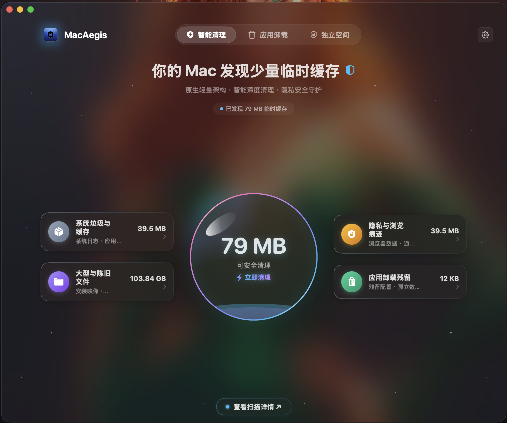
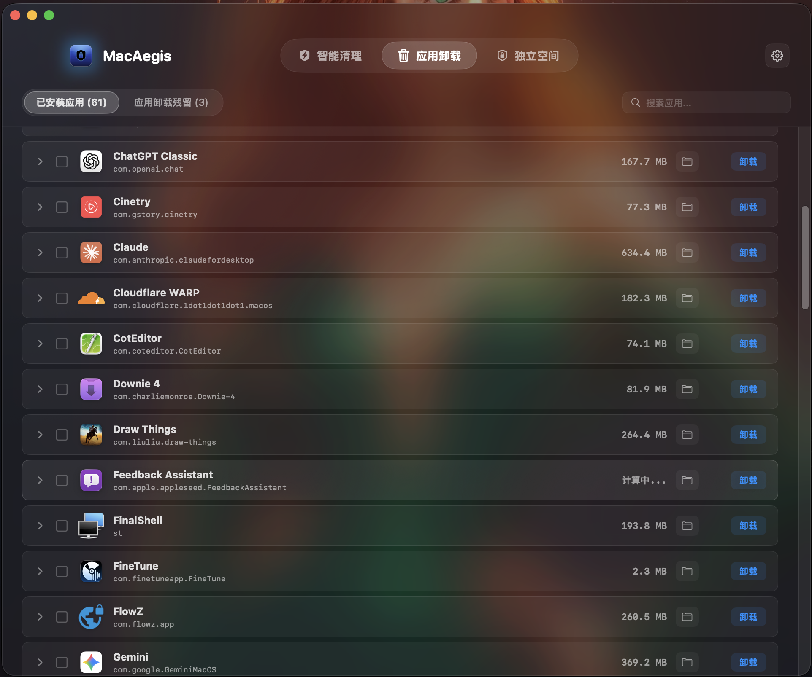
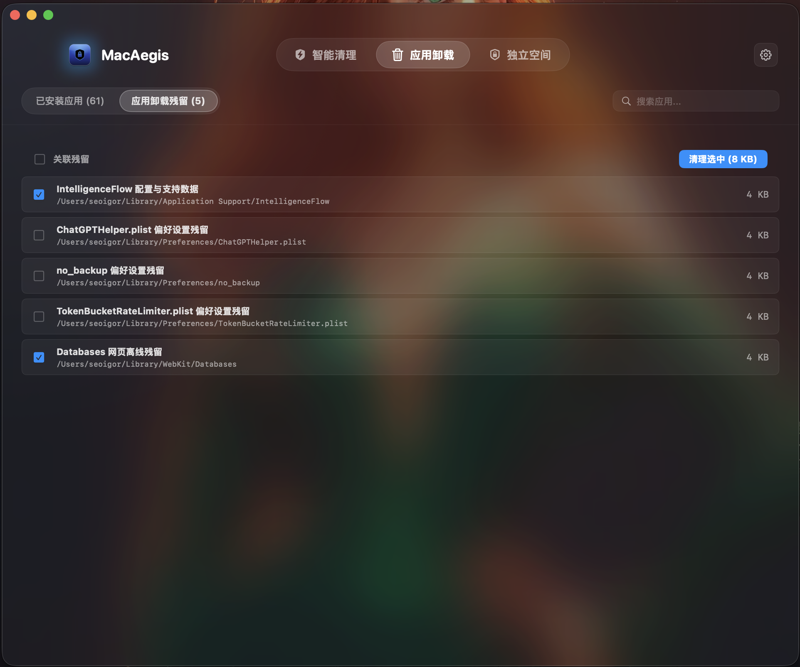
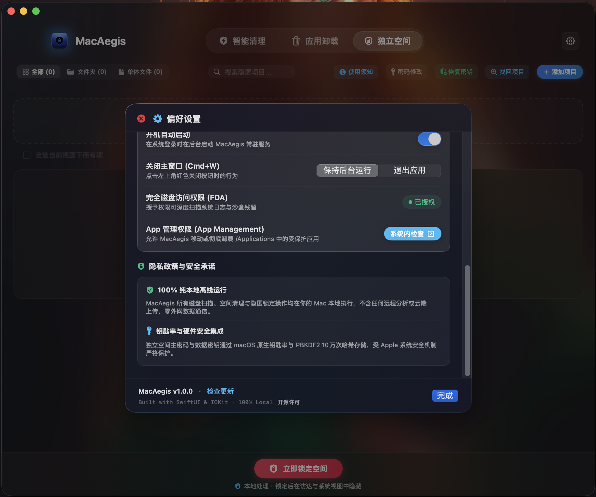
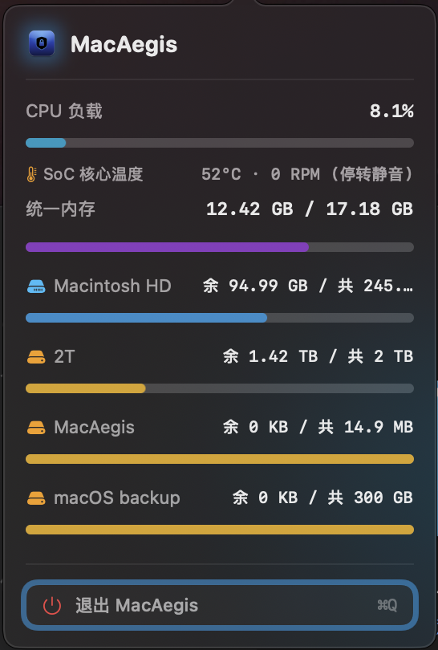

# MacAegis

一款专为 Apple Silicon 与 macOS 设计的原生极速系统深度清理与应用卸载引擎。

<p align="center">
  
</p>

<p align="center">
  
  
  
  
  
</p>

<p align="center">
  <a href="#软件介绍">软件介绍</a> •
  <a href="#开闭源架构说明">开闭源架构</a> •
  <a href="#功能概览与界面预览">功能预览</a> •
  <a href="#本地编译与运行指南">本地编译</a> •
  <a href="#贡献规则库">贡献规则</a> •
  <a href="README_EN.md">English Version</a>
</p>

---

## 软件介绍

MacAegis 是一款采用纯 Swift 6 原生构建的轻量级 macOS 系统维护工具。

为彻底消除用户对第三方清理软件的隐私顾虑与安全疑虑，MacAegis 正式将其核心清理引擎与应用卸载体系 100% 开放源码，接受全球社区审计与技术检验。

- 原生流动玻璃设计：纯 SwiftUI 与 Metal 原生渲染架构，深度契合 macOS 设计语言，无 Electron 冗余依赖，安装包仅约 1.9 MB，常驻内存与系统开销趋近于零。
- 0.05 秒 Spotlight 全盘穿透：彻底抛弃传统递归遍历造成的 50,000 文件硬截断缺陷，实现大型外置介质与多盘存储无漏网极速检索。
- 孤儿应用猎手 (Orphan Hunter)：穿透 macOS 沙盒元数据体系，精准逆向溯源已卸载软件遗留的深层容器残留。
- 微信 4.x 渲染缓存靶向修剪：精准剥离 Chromium / Radium 内核网页渲染缓存，绝对不触碰聊天记录与核心数据库。
- 100% 离线纯净承诺：零网络通信、零遥测回传、零私人文件读取，所有操作均在本地原位执行。

<p align="center">
  <a href="https://wise.com/pay/me/nongjinshui">
    
  </a>
  <br />
  <sub>请独立开发者喝杯咖啡 / Buy me a coffee</sub><br />
  <sub>作为初涉海外生态的独立开发者，目前正测试 Wise 跨境渠道；若本工具对您有所帮助，由衷感谢任何真实支持。</sub>
</p>

---

## 开闭源架构说明

MacAegis 采用开源核心 (Open-Core) 与专有安全功能并行的架构模式：

1. 开源核心 (GPL-3.0)：
   - 智能扫描引擎 (`ScannerEngine`) 与全套清理规则库 (`*Rules`)；
   - 应用深度卸载器 (`AppUninstaller`) 与孤儿残余追踪 (`OrphanHunterRules`)；
   - 硬件实时遥测 (`HardwareTelemetry`) 与状态栏卡片 (`MenuBarCardView`)；
   - 完整的 macOS 原生 UI 与流动玻璃视觉体系 (`Theme`, `LiquidGlass`)。
   - 任何人均可自由审查、本地编译、修改及参与规则共建。

2. 专有闭源组件 (Privacy Vault 独立空间)：
   - 原创隐匿引擎、算法及硬件安全隔区触控 ID 认证集成；
   - 该组件为个人原创底层技术，保留为专有闭源资产，免费供大家使用，不属于本开源仓库分发范围。

---

## 功能概览与界面预览

### 1. 智能清理主控台
直观呈现当前系统存储与健康概况，支持一键智能扫描系统缓存、日志与可清理垃圾，并提供大文件检索与分类明细。
<p align="center">
  
</p>

### 2. 已安装应用管理
清晰枚举本机全部已安装应用程序，直观展示安装包物理体积与版本信息，支持快速搜索与深度定位。
<p align="center">
  
</p>

### 3. 应用卸载与孤儿残留分析
自动追踪已卸载程序在系统偏好、应用支持目录及沙盒中遗留的孤立残留文件，协助彻底释放存储空间。
<p align="center">
  
</p>

### 4. 偏好设置与系统权限管理
提供开机自动启动、窗口关闭行为等系统级偏好调节，并直观指引完全磁盘访问权限（FDA）与应用管理权限状态。
<p align="center">
  
</p>

### 5. 状态栏硬件监控卡片
极低系统开销的菜单栏监控浮窗，实时反馈芯片核心温度、风扇转速、统一内存压力及各磁盘存储容量。
<p align="center">
  
</p>

---

## 本地编译与运行指南

### 环境要求
- 运行系统：macOS 14.0 (Sonoma) 或更高版本；
- 编译工具：Xcode 16.0+ 或 Command Line Tools (Swift 6.0+)；
- 架构支持：Apple Silicon (arm64) 及 Intel (x86_64)。

### 源码编译
```bash
# 克隆仓库
git clone https://github.com/meowvia/MacAegis.git
cd MacAegis

# 运行自动化测试套件
swift test

# 编译发布版本应用
swift build -c release
```

---

## 官方预编译镜像安装（含独立空间）

若需体验官方预编译镜像或包含专有「独立空间 (Privacy Vault)」的完整版：

1. 在 GitHub Releases 页面下载最新的 `MacAegis-vX.Y.Z.dmg` 安装包；
2. 双击挂载镜像后，将 MacAegis 拖拽至 Applications 目录；
3. 官方发布地址：https://github.com/meowvia/MacAegis/releases

---

## 贡献规则库

MacAegis 欢迎社区开发者为更多常用及冷门应用扩充清理规则。详细规范请参阅 CONTRIBUTING.md 指南。

---

## 隐私与安全声明

MacAegis 严格遵循本地最小权限原则：
- 本软件无任何网络连接代码；
- 完全磁盘访问权限 (FDA) 仅用于遍历缓存目录以计算体积；
- 涉及严重安全隐患的漏洞披露请参考 SECURITY.md。

---

## 开源协议

本项目开源代码部分采用 GNU General Public License v3.0 (GPL-3.0) 授权。独立空间 (Privacy Vault) 相关专利技术与闭源模块受专有商业版权保护。
