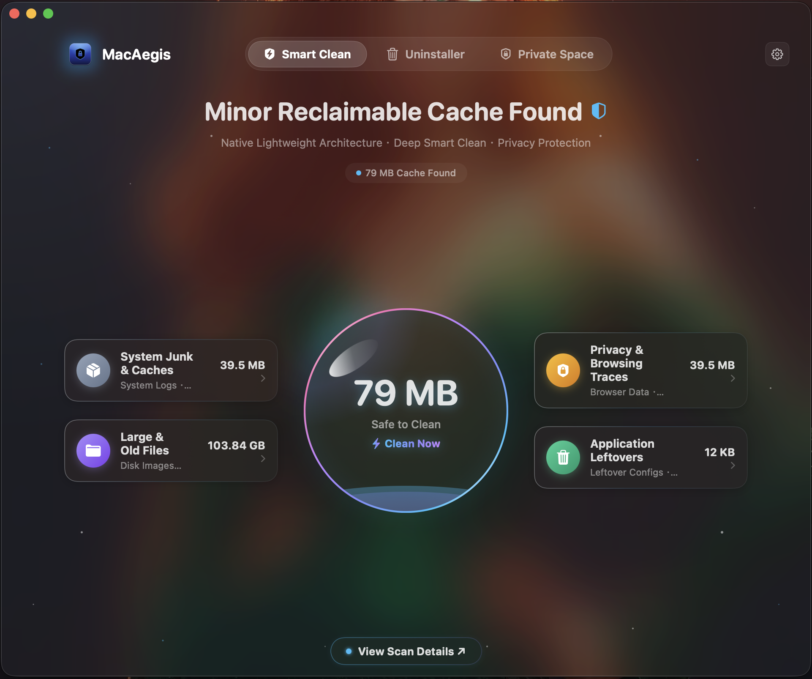
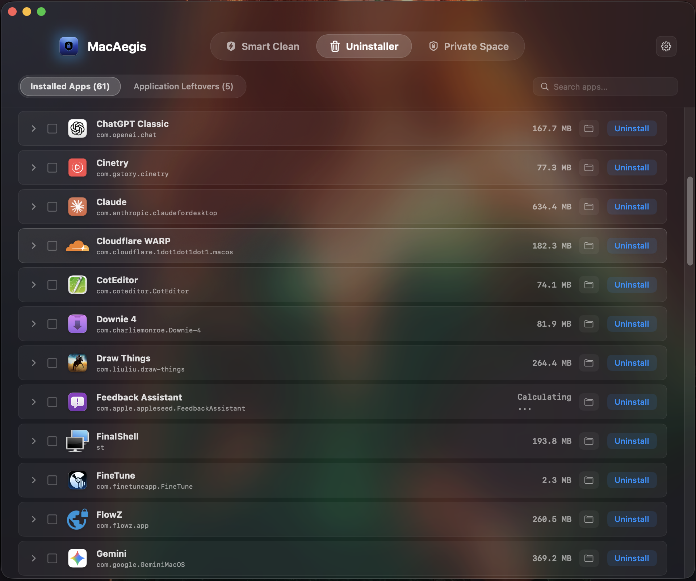
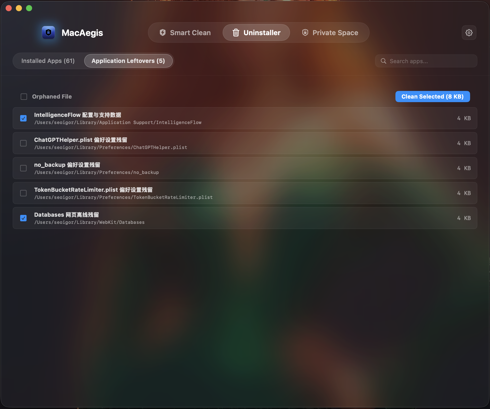
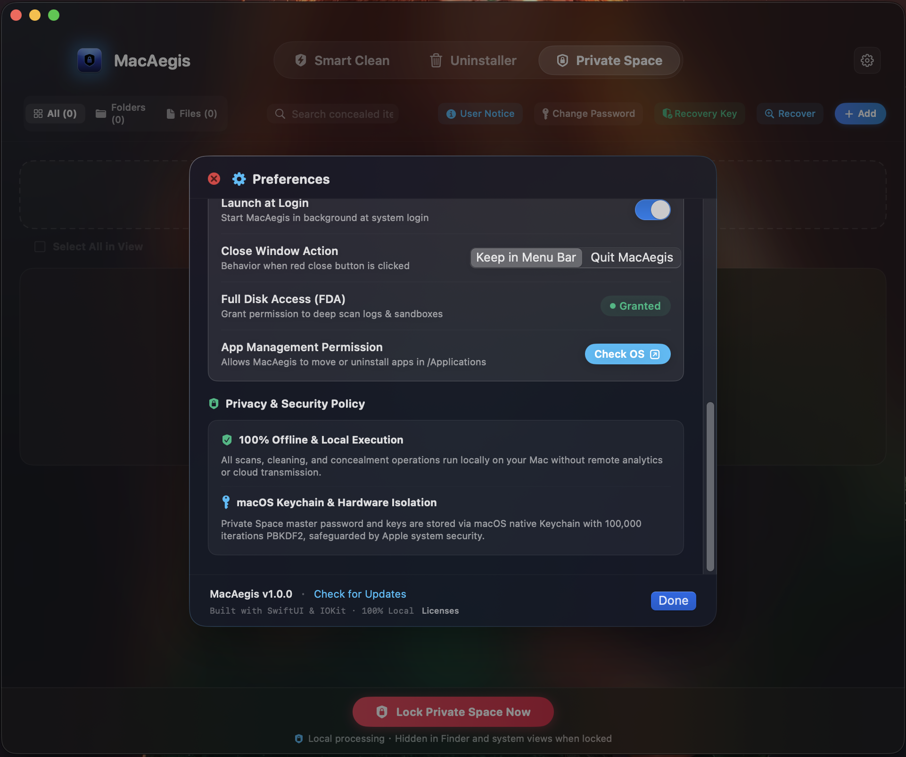
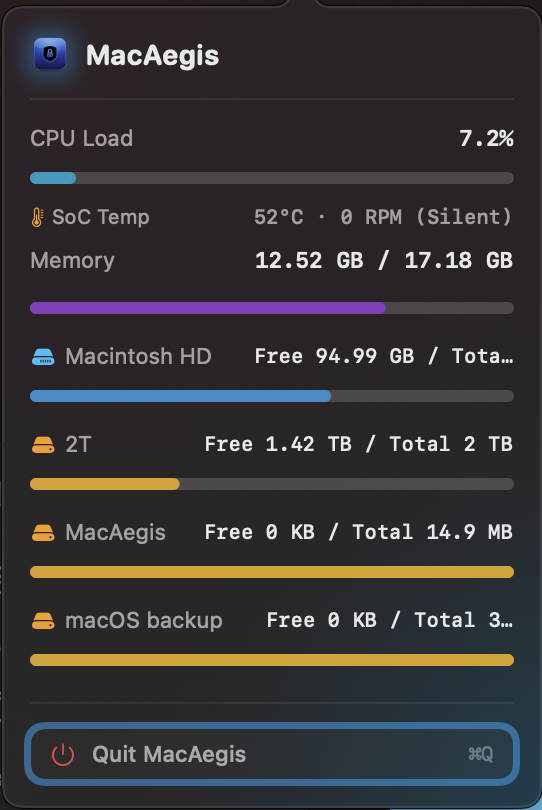

# MacAegis

A native, ultra-fast macOS deep cleaner and application uninstaller built specifically for Apple Silicon and macOS 14.0+.

<p align="center">
  
</p>

<p align="center">
  
  
  
  
  
</p>

<p align="center">
  <a href="#overview">Overview</a> •
  <a href="#open-core-architecture">Open-Core Architecture</a> •
  <a href="#feature-preview">Feature Preview</a> •
  <a href="#building-from-source">Building</a> •
  <a href="#contributing-rules">Contributing</a> •
  <a href="README.md">中文版本</a>
</p>

---

## Overview

MacAegis is a native macOS system maintenance utility engineered from the ground up with pure Swift 6.

To address industry-wide privacy concerns surrounding third-party cleaning tools, MacAegis makes its core cleaning engine and application uninstaller 100% open-source for public inspection and community verification.

- Native Liquid Glass Aesthetics: Pure SwiftUI and Metal vector rendering aligned with macOS design principles. Zero Electron bloat, resulting in a lightweight ~1.9 MB package and near-zero memory footprint.
- 0.05-Second Spotlight Traversal: Replaces legacy recursive enumeration, bypassing the notorious 50,000-file traversal cut-off bug to achieve instantaneous indexing across massive volumes.
- Orphan Hunter: Unearths abandoned sandbox containers by inspecting underlying `.com.apple.containermanagerd.metadata.plist` files.
- Surgical App Cache Trimming: Trims large web render caches (such as WeChat 4.x Chromium/Radium caches) without touching user chat records or SQLite databases.
- Zero-Telemetry Guarantee: Operates strictly offline. Zero network calls, zero telemetry, zero access to private file contents.

<p align="center">
  <a href="https://wise.com/pay/me/nongjinshui">
    
  </a>
  <br />
  <sub>Buy me a coffee</sub><br />
  <sub>Testing Wise cross-border channels; any genuine support for continuous indie development is deeply appreciated.</sub>
</p>

---

## Open-Core Architecture

MacAegis employs an open-core licensing model:

1. Open-Core (GPL-3.0):
   - Smart scanning engine (`ScannerEngine`) and complete cleaning rules (`*Rules`);
   - Application uninstaller (`AppUninstaller`) and orphan container detection (`OrphanHunterRules`);
   - Real-time hardware telemetry (`HardwareTelemetry`) and menubar monitor (`MenuBarCardView`);
   - Native macOS UI and Liquid Glass visual design system (`Theme`, `LiquidGlass`).
   - Fully open for auditing, building, and rule contributions.

2. Proprietary Component (Privacy Vault):
   - Original concealment engine, algorithms, and Secure Enclave Touch ID biometric integration;
   - Retained as a proprietary closed-source asset, free for all users, and excluded from this open-source repository.

---

## Feature Preview

### 1. Smart Clean Dashboard
Provides clear overview of system storage and health, enabling one-click scanning of system caches, logs, and junk items.
<p align="center">
  
</p>

### 2. Installed Application Management
Enumerates installed apps with physical package size, version metadata, and quick search.
<p align="center">
  
</p>

### 3. Application Leftover Reclamation
Tracks orphaned preferences and abandoned sandboxes from previously removed applications.
<p align="center">
  
</p>

### 4. Preferences and Permissions
Configures launch-at-login and provides clear guidance on Full Disk Access (FDA) status.
<p align="center">
  
</p>

### 5. Menubar Telemetry Card
Minimal-overhead menubar monitor reflecting chip temperature, fan speed, memory pressure, and volume usage.
<p align="center">
  
</p>

---

## Building from Source

### Prerequisites
- macOS 14.0 (Sonoma) or later
- Xcode 16.0+ or Swift 6.0+ Command Line Tools
- Apple Silicon or Intel Mac

### Build Commands
```bash
git clone https://github.com/meowvia/MacAegis.git
cd MacAegis

# Run automated tests
swift test

# Build release binaries
swift build -c release
```

---

## Official Binary Releases (Including Privacy Vault)

To experience the pre-compiled official image or the full suite containing the proprietary Privacy Vault:

1. Download the latest `MacAegis-vX.Y.Z.dmg` from the GitHub Releases page;
2. Mount the DMG image and drag MacAegis into the Applications folder;
3. Official Releases: https://github.com/meowvia/MacAegis/releases

---

## Contributing Rules

Community contributions for third-party application cleaning rules are warmly welcomed. Please consult CONTRIBUTING.md for implementation details and safety protocols.

---

## Privacy and Security Statement

MacAegis adheres strictly to the principle of least privilege:
- Completely free of network communication code;
- Full Disk Access (FDA) is utilized solely for traversing cache folders to compute sizes;
- For vulnerability reports, please consult SECURITY.md.

---

## License

The open-core components are licensed under the GNU General Public License v3.0 (GPL-3.0). The Privacy Vault module is proprietary software owned by meowvia.
